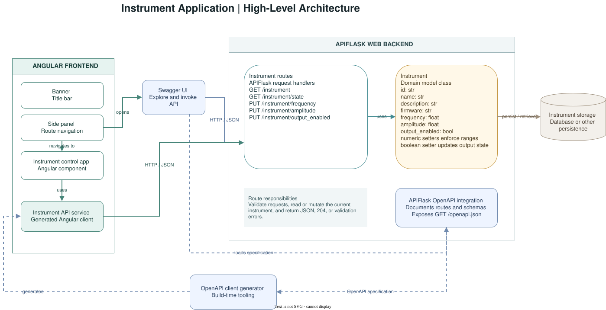

# Virtual Instrument Control API

## How to Run

To run the backend refer to its ['How to Run' section](./Backend/README.md#how-to-run).

To run the frontend refer to its ['How to Run' section](./Frontend/README.md#how-to-run).

## How to Interact with the API

To interact with the API, refer to the backend's ['How to Interact with the REST API' section](./Backend/README.md#how-to-interact-with-the-rest-api).

For more documentation, like examples or data contracts, visit the Swagger UI in the [same section](./Backend/README.md#how-to-interact-with-the-rest-api).

## Project Organization

The project is organized into a Python backend using APIFlask and a TypeScript frontend using Angular.

### The backend

#### Files and directories:

| Path | Purpose |
| --- | --- |
| `Backend/Data/Classes/` | Instrument model and state-changing methods. |
| `Backend/Data/Config/` | Instrument defaults, supported values, and limits. |
| `Backend/Data/Schemas/` | Marshmallow schemas for request validation and response serialization. |
| `Backend/Routes/` | REST API endpoints and their OpenAPI documentation. |
| `Backend/Services/` | Instrument provider for singleton and transient instances. |
| `Backend/Tests/` | Pytest fixtures and API endpoint tests. |
| `Backend/app.py` | Creates the APIFlask application and registers its routes. |
| `Backend/requirements.txt` | Backend dependencies. |
| `Backend/setup.py` | Installs dependencies from `requirements.txt`. |
| `Backend/README.md` | Backend setup, running, and API interaction instructions. |

#### Main elements:

* An APIFlask app that registers routes to drive the REST API.
* An internal representation of an instrument in the form of a class, with a singleton provided by the instrument provider service.
* Marshmallow schemas to validate requests, serialize responses, and support endpoint documentation.

### The frontend

#### Files and directories:

| Path | Purpose |
| --- | --- |
| `Frontend/src/app/core/services/` | Handwritten API shim over the generated OpenAPI client. |
| `Frontend/src/app/features/info/` | Instrument information page and its presentation styles. |
| `Frontend/src/app/features/state/` | Typed instrument-state form, update behavior, validation feedback, and presentation styles. |
| `Frontend/src/app/shared/components/banner/` | Shared application banner. |
| `Frontend/src/app/shared/components/sidebar/` | Shared collapsible sidebar and route navigation. |
| `Frontend/src/app/generated-api/` | Generated API services and data contracts. |
| `Frontend/src/app/app.component.*` | Root application shell that composes the shared layout and routed content. |
| `Frontend/src/app/app.routes.ts` | Info and State page routes and default redirects. |
| `Frontend/src/main.ts` | Bootstraps the Angular application. |
| `Frontend/src/styles.css` | Global theme and base element styles. |
| `Frontend/README.md` | Frontend setup and running instructions. |

#### Main elements:

* Collapsible sidebar with navigation to the Info and State routes and a link to the backend documentation.
* Main stage for the routed Info and State components.

## Main Decisions

### On core requirements

For the language, I decided to go with Python as it is an excellent language to create quick prototypes or simple projects. I also considered using C# for its .NET framework. However, I chose Python since its lightweight web API framework APIFlask provides a quick way to implement the core requirements of this project.

APIFlask seamlessly generates an OpenAPI description (OAD), it supplies a Swagger UI (plus other OAD UIs) that facilitates documentation visualization and endpoint testing, and it made data validation trivial. Unlike Flask, APIFlask has the essentials for this project without requiring plugins.

Responsibilities are well-defined.
For data validation, I heavily relied on Marshmallow schemas. Schemas allow the user to define the contract for the shape of input json payloads in the routes. If a schema fails to validate the input as the schema specified in the route, APIFlask returns a validation-error response (with the proper HTTP code). This approach also helps decoupling the data contracts from the internal representation of the model.

Updating the model, then, becomes the responsibility of the class and the controller.  

Managing the right instance of the class is the responsibility of the instrument provider service, which provides a singleton for the main logic and transient instruments for testing.

Finally, I added a Python config file. This may come across as a little clunky, but it allows us to trigger app reloading (if the app is run with the --reload flag). This means that you may play with the configuration without manually reloading the app.

All in all, simplicity and a clean architecture drove my decisions.

### On optional enhancements

The OAD has another major advantage: it allows us to generate AngularTS clients for our frontend app.
The generated client supplies typed interfaces and Observable-based HTTP operations. The shim converts those operations to Promises and normalizes API errors, reducing handwritten HTTP code.

I decided to structure my GUI with two shared components, a banner and a sidebar, and routed components for Info and State. Also, I have a shim service over the autogenerated client to simplify operations.

## Project Architecture Diagram

